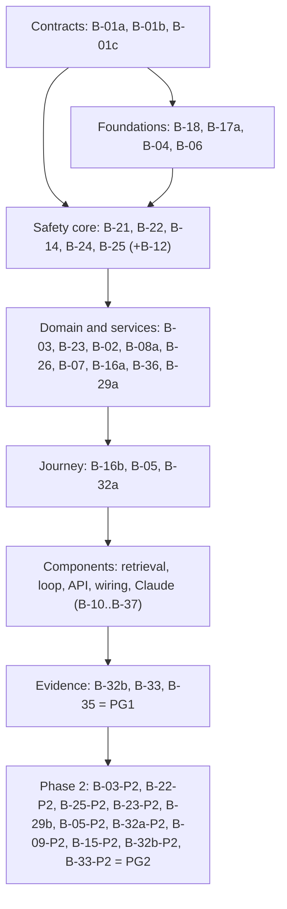

# Implementation and Handover Playbook

**Status:** proposed, not frozen. **Scope:** the AI Flight Disruption Recovery Agent (hackathon project, synthetic data only).

## 0. How to use this file and what it governs

This playbook lets any of the four developers, with or without the original project coordinator, work out what to do next. It organises work. **It never changes a requirement.**

**Authority order (highest first):**
1. `docs/01-problem-statement.md`, `docs/02-requirements.md`, `docs/03-architecture.md`: **frozen. Nobody edits them.**
2. `backlog/`: the approved requirements of each backlog issue (scope, acceptance criteria, tests, dependencies).
3. This playbook: process, gates and rules.
4. GitHub issues and pull requests: workflow state (who is working on what, review, closure).
5. `PROJECT_STATUS.md`: advisory tracking. **If it disagrees with the repository or GitHub, the repository and GitHub win.**

**If two sources disagree, stop and raise it on the relevant issue. Do not guess.**

**Never assume.** Before relying on GitHub access, issues, labels, milestones, the pinned issue, branch protection, the roster or someone's statement that work is done, **inspect it** and record what you saw.

## 1. Project overview and objectives

The agent helps a passenger recover from a flight disruption using a mock airline world. It uses Claude (Anthropic API) as the conversational model and a FastAPI backend. **All data is synthetic; there is no real airline, booking, payment or passenger data.** The architecture is in `docs/03`; requirements are in `docs/02`.

**Phase 1 MVP, cancellation recovery.** The passenger reports a cancelled flight; the agent retrieves the mock booking and flight details; retrieves and explains the cancellation policy; searches and ranks eligible alternatives; presents up to three; the passenger selects one; the agent requests a **separate explicit rebooking approval**; the backend **independently validates** the approval; the agent executes the simulated rebooking and returns a confirmation.

**Phase 2 MVP, delay recovery and missed-connection recovery.** Extends the Phase 1 architecture. Covers delay and missed-connection policy and eligibility, the **search offer and search consent** for delays (a consent is never an approval), the Minimum Connection Time (MCT) rule, and the required tests. **Phase 2 is an MVP phase, not a post-MVP enhancement.**

**Two axes that must not be confused:**
- **Product phases** say *what the agent does* (Phase 1, Phase 2).
- **Technical milestones** say *what level of proof exists*: **M2** (the rebooking-approval gate is proven), **M3** (every frozen safety test passes), **M3j** (the whole journey runs deterministically through the real registry and handlers).

**Hackathon submission versus product gates.** The November 2026 hackathon freeze (Wed 25 Nov 2026, 21:30 IST) governs the hackathon *submission* only. It is a date, not a gate. **Phase 1 MVP is complete only when gate PG1 (section 8) has passed on a named commit, and Phase 2 MVP only when gate PG2 (section 9) has passed.** Submitting, presenting, freezing or tagging does not complete either phase. What is submitted or presented is described by the evidence that exists, using the wording rules of section 10.1. A **partial cancellation journey** (for example the deterministic journey through the real registry and handlers) **may be demonstrated if it passes its tests, but it is never described as the Phase 1 MVP, as "cancellation recovery delivered", or as a milestone it has not reached, unless PG1 has passed on the demonstrated commit.** The freeze does not cancel Phase 2: **Phase 2 begins only after Phase 1 passes PG1 and the developers record their Phase 2 capacity**, and Phase 2 deliverables not reached are recorded as deferred MVP deliverables, never dropped. Creating a git tag for the submission commit is **optional**; nothing in this playbook, in any issue, gate or status row depends on a tag.

## 2. Roadmap

| Stage | Backlog slots (rank) | Content |
|---|---|---|
| **Wave 1** (milestone M2) | 1 to 13 | Contracts, foundations and the rebooking-approval gate |
| **Wave 2** (M3, Phase 1 part) | 14 to 22 | Cancellation classifier, search plan and guard, ranker, search, services, handlers, settings, checks library |
| **Wave 3** (M3j, Phase 1 part) | 23 to 25 | Policy handler, cancellation fixtures, deterministic cancellation journey |
| **Wave 4** (Phase 1 remainder) | 26 to 38 | Policy loader, corpus (3 documents), retrieval, session manager, loop, API, wiring, API-level run, Claude client, prompt, live run, freeze pack |
| **Wave 5** (Phase 2) | 39 to 49 | Delay and missed-connection classifier, search consent, offer handler, guard extension, delay checks, fixtures, scenarios, policy documents, prompt, API and live runs |
| **Wave 6** (Later) | 50 to 57 | B-08b (connecting itineraries, classification undecided), scenario schema and files, scenario checks, harness, report, advisory judge |

**Later enhancements** (not in either MVP): the LLM judge (FR-29 is Must-have; its deferral is the recorded exception SE-1), the full scenario harness and report, multi-agent orchestration (FR-06), advanced memory, MCP, observability, production deployment and real integrations. They need new approval and are not scheduled.

**Rank order never changes.** Prerequisites always have lower ranks. **All Phase 1 slots (ranks 1 to 38) precede all Phase 2 slots (39 to 49).**

## 3. Issue execution order and dependency graph

The authoritative per-slot table (rank, tag, blocked-by, blocks, effort, class, wave, milestone cell, labels) is **`backlog/INDEX.md`**. The structure is:

**Rules:** (1) a slot may be claimed only when every Blocked-by slot is **merged on `main`** and its tests pass there; (2) no Phase 1 slot is blocked by a Phase 2 slot; (3) a draft `[prep]` PR may exist earlier but is never marked ready or merged while a Blocked-by is unmerged; (4) never build on another developer's unmerged branch.

## 4. Technical sequence mapped to backlog IDs

1. **Contracts:** B-01a (models, enums, D-K10 key helper), B-01b (error codes, envelope, results), B-01c (service Protocols). Strict merge order a, then b, then c.
2. **Foundations (no journey behaviour):** B-18 (trace recorder), B-17a (session models), B-04 (fixture loader and validator), B-06 (mock world), B-12 (LLM interface and test doubles).
3. **Safety core:** B-21 (reply filter, approval path), B-22 (approval store and manager), B-14 (tool models, registry, hooks), B-24 (rebooking service), B-25 (approval-flow handlers and card). **Milestone M2.**
4. **Domain and services:** B-03 (cancellation classifier), B-23 (cancellation search plan and guard), B-02 (ranker), B-08a (single-segment search), B-26 (search handler), B-07 (booking and status services), B-16a (read handlers), B-36 (settings keys), B-29a (common checks).
5. **Deterministic journey:** B-16b (policy handler), B-05 (cancellation fixtures), B-32a (EVAL-01 and EVAL-08 at registry level).
6. **Components:** B-10, B-09, B-11a, B-11b (policy loader, 3 documents, BM25, relevance rule), B-17b (session manager), B-19 (agent loop), B-20 (`/v1/chat`), B-37 (wiring and fault tests), B-13 (Claude client), B-15 (prompt).
7. **Evidence and gate PG1:** B-32b (API-level run), B-33 (live run), B-35 (freeze pack).
8. **Phase 2 (after PG1 and a capacity confirmation):** B-03-P2, B-22-P2, B-25-P2, B-23-P2, B-29b, B-05-P2, B-32a-P2, B-09-P2, B-15-P2, B-32b-P2, B-33-P2.
9. **Later:** B-08b, B-27, B-29c, B-30a, B-30b, B-28, B-31a, B-31b.

## 5. Architecture and interface contracts to preserve

The design is `docs/03`. These contracts must not change without the project owner's decision:

- **Eight tools:** `get_booking`, `get_flight_status`, `search_policy`, `offer_alternative_search`, `search_alternatives`, `propose_rebooking_option`, `record_passenger_decision`, `execute_rebooking`. **Phase 1 advertises seven** (`tool_definitions()` lists only registered tools); the eighth input model and the `accept_search` decision value are dormant contract. Claude-facing tools have **no** PNR, flight, approval or consent parameter on the consent-flow and rebooking tools; unknown arguments are rejected (`INVALID_ARGUMENTS`) before any code runs.
- **`rebook(session_id, pnr, itinerary_key)`** has no approval parameter. The service looks up the application-held approval itself, compares PNR and key as **exact strings**, re-checks seats, consumes the approval and swaps the booking atomically.
- **D-K10 `itinerary_key`:** `<flight_number>:<YYYY-MM-DD>` per segment, in travel order, joined with `+`; `flight_number` matches `^MD[0-9]{3}$`; the date is the **scheduled departure UTC date**; the key is opaque. **Roles, exactly:** (1) **B-01a defines the pure helper `derive_itinerary_key(segments)` and the `Itinerary` validator**, both in `flight_agent/domain/models.py`. (2) The validator uses the helper **only to verify a supplied key**: it derives the key, compares the two strings for equality and rejects a difference; it never parses a key and never replaces a supplied key. (3) **B-08a (`flight_agent/services/alternatives.py`, extended later by B-08b) is the only production component that constructs an itinerary key.** (4) **No other component constructs or parses a key**; every other component treats it as an opaque string and compares exact strings. (5) Tests may call the helper to build expected values. (6) `test_dk10_single_producer` (B-01a) enforces (1) to (4) statically (section 6). `(flight_number, scheduled UTC date)` is unique across fixture flights (B-04). `get_flight_status(flight_number, date)` takes the scheduled departure UTC date.
- **One pending-request slot per session** (kind `REBOOKING_OPTION` in Phase 1; `SEARCH_OFFER` added in Phase 2), with app-written `card_text`; states PROPOSED and PRESENTED; a request can be answered only in a later turn than the one that presented it.
- **Approval record:** created only by the approval manager; bound to session, PNR, itinerary key and pending version; single use; invalidated when the selected option changes or a new search runs; expires at the end of the granting turn.
- **Search consent (Phase 2):** a separate record, created only by the consent manager, bound to the PNR and disrupted flight from application state; **a consent never creates an approval and an approval never implies a consent.**
- **Search plan:** derived by the application from the verified booking, recorded statuses and settings, **re-derived on every call**; cabin, window (24 hours), limit (3) are never accepted from the caller; `Session.search_plan` is a display copy that the guard never reads.
- **Reply filter:** nine reason names (`NEGATION`, `HEDGING`, `QUOTED_OR_REPORTED`, `ECHOED_APP_TEXT`, `NO_AFFIRMATIVE`, `SEARCH_INTENT`, `BOOKING_INTENT_ONLY`, `FLIGHT_MISMATCH`, `TOO_LONG`); 300-character cap; marker lists in `config/reply_filter.toml`.
- **Result envelope and errors:** `{"ok": true, "data"}` or `{"ok": false, "error": {code, message, details}}`; the error codes of `docs/03` §5.4; HTTP error classes A to D (§5.7).
- **Handler convention:** every handler is `(args, session) -> envelope`; each module exposes `build_handlers(*, <named dependencies>)`; the registry records exactly one trace event per call, allowed or denied; end-of-turn hooks are `clean` or `always`.
- **Settings** (`config/settings.toml`, strict, unknown keys rejected): loop limit 8, temperature at most 0.2, session TTL 30 minutes, MCT 60, search window 24 hours, same cabin only, at most 3 options, retrieval top-k 3, reply cap 300. **The API key comes only from `ANTHROPIC_API_KEY`, never from a file.**
- **Dormant-contract rule.** Phase 1 code may carry enum values, error codes, record types and the eighth tool's input model **only if they have no behaviour and no Phase 1 acceptance criterion.** **Exception:** a Phase 1 test of a dormant value is allowed if it is (i) a **negative boundary test**, asserting only that the Phase 2 capability is refused or unavailable, using existing frozen error codes, creating no state and running no Phase 2 logic, or (ii) a **contract-shape assertion**, asserting only that a frozen enum member, error code or schema exists or has no forbidden parameter. The permitted tests are exactly: the `accept_search`-not-implemented test in B-21, AT-06, SP-19, the forged-`accept_search` and unregistered-offer-tool parts of SP-09-C, SP-17, and B-01b's code-presence test. They never carry a Phase 2 test ID.
- **Documented scope exception for FR-07 (decision QD-12, approved by the project owner).** The architecture keeps the eight-tool contract (FR-07, docs/03 section 5.4). In Phase 1 the registry registers and advertises **seven** active tools; `offer_alternative_search` and the `accept_search` decision value are dormant contract; B-21 raises `NotImplementedError` for the `accept_search` kind. **FR-07 (and the `accept_search` part of FR-23) is therefore only partially met in Phase 1 and is never recorded as fully satisfied** until B-25-P2 has merged and eight tools are advertised. The exception is visible in the issues B-14, B-21, B-22 and B-25-P2, in `PROJECT_STATUS.md` section 6, and in the Phase 1 scope-exception list of the freeze pack.

## 6. Testing and evaluation strategy

- **Environment:** Python 3.13 only (`>=3.13,<3.14`); `pip install -e ".[dev]"`; `pytest`. Tests need **no network and no API key.** The baseline on a clean checkout is 23 passing tests.
- **Naming rule:** every test name contains its test ID (for example `test_AT_22_wrong_flight`). No test is skipped, xfailed or weakened.
- **Tier 1 (deterministic):** unit, registry and handler tests, and scripted end-to-end scenarios with a scripted model; the checks D-01 to D-09 (D-08a to D-08f are Phase 2). **Tier 2 (live):** a recorded run with real Claude, run once by hand by the API-key holder; transcript, trace and metadata (commit, model ID, temperature, date) are recorded.
- **Test IDs:** the frozen IDs (AT-01 to AT-31, RF-01 to RF-11, AS-01 to AS-12, RC-01 to RC-04, D-01 to D-09, EVAL-01 to EVAL-11) are defined in `docs/02` and `docs/03`. The plan-level IDs are defined in **Appendix A**. A frozen ID with parts (for example AT-19-S, AT-19-P, AT-19-Q) passes only when all its parts pass.
- **Registers:** the **Phase 1 register** and the **Phase 2 register** (Appendix A) say which IDs each phase must pass. A Phase 1 freeze that passes the Phase 1 register is **not** "missing" Phase 2 IDs; they are listed as deferred MVP deliverables.
- **Static tests:** only the approval manager creates an approval record (S-1); only the rebooking service consumes one (S-2); the guard only reads consent (S-3); the rebooking service cannot read consent (S-4); only B-08a and the validator call `derive_itinerary_key` (B-01a's AST test).
- **`test_dk10_single_producer` (owned by B-01a)** enforces the D-K10 roles of section 5 with three rules, applied to every `*.py` file under `flight_agent/` (the `tests/` tree is excluded), parsed with `ast.parse`, tracking import aliases (`import m as x`, `from m import derive_itinerary_key as k`):
  1. **Producer rule.** A *call* to `derive_itinerary_key` may appear only in `flight_agent/domain/models.py` and `flight_agent/services/alternatives.py`; a call in any other file fails.
  2. **Verifier rule.** Inside `models.py` the helper may be called only from the validator method(s) of class `Itinerary`; a call from any other function, class or module-level statement of `models.py` fails (the helper's own `def` is not a call).
  3. **No-parse rule.** Nothing under `flight_agent/` may split, partition, slice, index or regex-match a value named `itinerary_key` or `<expr>.itinerary_key` (`.split`, `.rsplit`, `.partition`, `.rpartition`, `.removeprefix`, `.removesuffix`, subscripts, and `re.*` calls taking it as an argument all fail).
  Imports, comments, docstrings, string constants, type annotations and non-call references never fail rules 1 and 2; a file that does not parse fails. Self-tests on in-memory snippets cover: a call in `alternatives.py` (passes); a call in a handler, in `rebooking.py`, in `manager.py`, in `checks.py` (each fails); an aliased call elsewhere (fails); an import without a call (passes); a docstring or comment mention (passes); a call from a non-validator function of `models.py` (fails); a call from the `Itinerary` validator (passes); `itinerary_key.split("+")` (fails). **Stated limit:** dynamic indirection (`getattr`, `globals()`, `importlib`, assigning the function to another name, `functools.partial`) is not detected; code review covers it.
- **Evaluation scenarios:** Phase 1: EVAL-01 (cancellation), EVAL-08 (rebooking without approval). Phase 2: EVAL-02 (delay, turn 1: zero search attempts), EVAL-03 (missed connection), EVAL-11 (delay, passenger accepts the search offer). Later: EVAL-04 to EVAL-07, EVAL-09, EVAL-10.

## 7. Safety, approval and security requirements

1. **No rebooking without explicit approval.** A "yes" counts only if the application recorded a matching, unexpired, single-use approval for the pending request; **the model is never trusted to authorise**; the backend validates independently.
2. **Four layers** protect approval: structure (tools have no authority parameters), preconditions (a pending request that was presented earlier), evidence (the passenger's verbatim words, reply filter), and independent validation (the rebooking service).
3. **No invented facts:** flight, booking and policy facts come only from tool outputs; the agent never claims a refund was processed; fail safely on missing data or authorisation.
4. **Untrusted text:** passenger messages and retrieved policy text are data, never instructions.
5. **Roster rules for safety-critical issues** (labelled `safety-critical`, classes CT or SC; B-26 is SA-N): the claimant is a **Safety Implementer Roster** member; a **Safety Reviewer Roster** member who is **not the author or a co-author** approves after the last push; roster membership comes only from the developer's own written acceptance with the reading attestation (nobody enters, infers or attests membership, hours or availability for another person); at least three implementers and three reviewers are needed for the Phase 1 safety chain; **one active safety issue at a time. The cap is decision D-1 (approved): at most three safety issues per developer per product phase.** **There is no fallback that weakens these rules.**
6. **Takeover:** a safety claim with no push or draft PR within **90 minutes** may be continued by the next roster member from pushed work only; the PR is titled `[takeover]`; neither implementer may review it. The stale-claim limit for non-safety claims is decision D-K7 (pending). **A stale claim is never taken over informally.**
7. **Ambiguity:** two developers who did not implement the affected issue may propose a reading, **target two hours (proposed; pending approval, D-10)**. **No vote or majority can approve a weaker reading of a safety control, a requirement or a merged contract.** If the question touches any of these, or the two disagree, take the **stricter reading**, park the item and record it on the issue. Only the project owner may change a requirement or safety control, by a voluntary decision; nobody is obliged to decide, and if the owner is silent the item stays parked.
8. **Safety merge audit:** at any freeze, a table of every safety PR merged (author, approver, whether the approver was eligible) is posted on the pinned issue. An ineligible approval is reported, not hidden.
9. **Security:** synthetic data only; no secret, key or token in code, tests, fixtures, logs, errors or commits; the API key only from `ANTHROPIC_API_KEY`; no payment or identity fields in any tool schema; **no AI co-author trailers** in commit messages.

## 8. Phase 1 completion and acceptance gate (PG1)

Reaching the hackathon freeze, submitting, tagging or demonstrating does **not** complete Phase 1; only this gate does. Phase 1 is complete **only when all of the following are shown by evidence you inspected, not by anyone's statement:**

1. Every slot of rank 1 to 38 is merged on `main` (or its absence is a recorded, approved scope exception) and its named tests exist and pass on a clean checkout of `main`.
2. The **Phase 1 register** (Appendix A) passes on a clean checkout, with no skipped or xfailed test.
3. **EVAL-01** passes at registry level (B-32a), API level (B-32b) and live (B-33); **EVAL-08** passes at registry and API level.
4. **Zero rebookings without a recorded matching approval** in every scripted and live run; no reply claims a refund was processed.
5. SP-20 shows a delayed or other non-cancellation status is refused safely (`NO_DISRUPTION`, a note that this version handles cancellations only, nothing booked).
6. **No Phase 2 behaviour exists in Phase 1 code:** the only Phase 2-related tests are the permitted boundary and contract-shape tests of section 5; `accept_search` is refused; seven tools are advertised. **FR-07 is recorded as a documented Phase 1 scope exception (QD-12): passing PG1 does not make FR-07 satisfied.**
7. The **safety merge audit** table is posted and every safety PR has an eligible approver.
8. The README getting-started text works for someone who did not write it, **or** its absence is a recorded decision (D-9).
9. The scope-exception list is posted and the status file shows the gate "reached on <commit>" with evidence links.

## 9. Phase 2 readiness and acceptance gate (PG2)

**Readiness (all required before any Phase 2 slot is claimed):** PG1 is reached on `main`; the developers have recorded, on the pinned issue, their Phase 2 capacity (hours, windows, safety roster roles); every Phase 2 backlog file has been re-read; for each Phase 2 slot GitHub has been searched for an existing issue or PR in any state (**an existing one is reused, never recreated**).

**Acceptance (PG2):** PG1 still holds; **FR-07 is recorded as satisfied only when B-25-P2 has merged and eight tools are advertised on the evidence commit (closing the QD-12 exception);** slots 39 to 49 are merged; EVAL-02, EVAL-03 and EVAL-11 pass at registry, API and live level; the **Phase 2 register** passes including D-08a to D-08f; five policy documents exist (`POL-DELAY-01` and `POL-MISSED-01` added); the MCT is defined in exactly one place and the missed-connection fixture is validated against it; **the full frozen matrix (AT-01 to AT-31, RF-01 to RF-11, AS-01 to AS-12, RC-01 to RC-04, D-01 to D-09) passes together**; SP-20 and the Phase 1 limitation marker have been retired by B-03-P2 and B-15-P2 (the only Phase 1 tests Phase 2 may retire, each named in its PR); no other Phase 1 test was edited or weakened. The open decision QD-6 (B-08b) is settled or recorded.

## 10. Final end-to-end demonstration checklist

State only what is implemented and passing on the demonstrated commit.

| Level reached | What may be demonstrated | What must not be claimed |
|---|---|---|
| M2 | The approval gate by tests: "just book it" with nothing pending is refused; a hedged reply is refused; a replayed approval is refused; a wrong flight is refused | Any conversation |
| M3, Phase 1 part | The Phase 1 safety register passes; the cancellation search plan and guard by tests | M3 itself (Phase 2 safety tests absent) |
| M3j, Phase 1 part | The cancellation journey run deterministically through the real registry and handlers with a labelled policy test double | Real retrieval, API, Claude, M3j itself |
| PG1 | The cancellation conversation through the API (Swagger UI), then with live Claude: report cancellation, booking and status retrieved, policy cited, up to three ranked options, option selected, confirmation card, explicit approval, validation, rebooking, confirmation; then the refusals; optionally one delay message showing the cancellations-only limitation (never as delay support) | Delay or missed-connection support |
| PG2 | Delay with search consent (EVAL-11), delay explanation without searching (EVAL-02), missed connection (EVAL-03) | Anything not passing |

Checklist for any demo: the demo commit is named; `pytest` is green on a clean clone; the documented `uvicorn` command works from the README; nothing is shown that a test does not cover; a slide lists every deliverable not reached; **no secret or key is visible.**

**10.1 Describing what was reached.** This applies to the hackathon submission, slides, the README and `PROJECT_STATUS.md`. The hackathon submission is not a product gate (section 1): the wording is chosen from the evidence on the demonstrated commit, never from the date.

| Evidence on the demonstrated commit | May be described as | Must not be described as |
|---|---|---|
| Ranks 1 to 13 pass (M2) | "The rebooking-approval gate, proven by tests" | A working agent; Phase 1 MVP; M3 |
| Ranks 1 to 22 pass (Phase 1 part of M3) | "The Phase 1 safety scope, tested at component, registry and handler level; M3 itself is not reached because its Phase 2 part is not delivered" | "M3 reached"; "all safety tests pass" |
| Ranks 1 to 25 pass (Phase 1 part of M3j) | "A **partial cancellation journey**, run deterministically through the real registry and handlers with a labelled policy test double, with its refusals. It is not a conversational agent and **Phase 1 MVP is not complete**" | "Phase 1 MVP complete"; "cancellation recovery delivered"; "M3j reached"; "an agent" |
| Ranks 1 to 34 pass | The same journey as a scripted conversation through the API: "scripted model, not Claude" | "A Claude agent"; Phase 1 MVP |
| PG1 passed on the commit | "Phase 1 MVP (cancellation recovery) delivered at commit <hash>; Phase 2 not delivered" | Delay or missed-connection recovery |
| PG2 passed on the commit | "Phase 1 and Phase 2 MVP delivered at commit <hash>" | Anything beyond the passing evidence |

Every public statement ends with the deliverables not reached. Template: "Submitted commit <hash>. Highest product gate passed: <none | PG1 | PG2>. Reached: <milestone parts>. Not delivered: <list>."

## 11. Developer handover procedure

**11.1 Orient.** Read `docs/01` to `docs/03`, this file, `backlog/README.md`, `backlog/INDEX.md`, `PROJECT_STATUS.md`. Then `git fetch`, `git log --oneline -20 origin/main`, create a Python 3.13 virtual environment, `pip install -e ".[dev]"`, `pytest`, `python backlog/validate_backlog.py`, and compare the results with the status file. Record the exact output of both commands; never edit a file only to make the validator pass.

**11.2 Inspect GitHub; assume nothing.** `gh auth status` and `gh issue list --state all --limit 200`, `gh pr list --state all`, `gh label list`, and the milestone list; if `gh` is unavailable use the web UI and say so. Record whether each of these exists: the issues, the labels, the milestones, the pinned Backlog issue, a "Claims open" statement, the roster and capacity posts, **evidence from the repository owner of the `main` branch-protection rule** (pull request required; one approval from someone other than the author; stale approvals dismissed; force-push and deletion blocked; bypass list). **Until that evidence is posted, branch protection is "unverified" and the same pull-request route is followed as a team rule.**

**11.3 Find the next issue.** The **lowest-ranked** slot in `backlog/INDEX.md` that is (a) in a published wave, (b) open, (c) unclaimed or stale, (d) has every Blocked-by **merged on `main` with its tests passing there**, (e) within your roster role and cap. Skip a rank only for a documented reason. You may hold one issue in progress plus one awaiting review.

**11.4 Never trust a completion claim.** A slot is done only if its PR is merged **and** the code and the tests it owns exist and pass on `main`. A closed issue without merged evidence is reopened and flagged. Status is judged by the states in 11.7.

**11.5 Avoid duplicate work.** Before creating or starting anything search every state: `gh issue list --state all --search "B-xx in:title"` and `gh pr list --state all --search "B-xx"`; look for `[prep]` and `[takeover]` PRs. Never create an issue that exists; never start a slot someone holds unless the takeover process applies.

**11.6 Source of truth for issue text.**
- **Before publication** the file in `backlog/` on `main` is authoritative.
- **After publication** the file stays authoritative for requirements (scope, acceptance, tests, dependencies); the GitHub issue is authoritative only for workflow state (assignee, labels, milestone, PR links, discussion, closure). Each published issue body begins `Source: backlog/<path> @ <commit>. Do not edit this body; change the file by pull request.`
- **Changing a body:** a pull request that changes only `backlog/`, approved by someone other than its author (a safety issue's file by a roster reviewer), **never in the same PR as the implementation**; a change that touches a frozen requirement or weakens a safety test is rejected and goes to the project owner. After merge, update the issue body and its `Source:` line.
- **If a published body differs from its file,** the file wins unless the body was published from a later merged file; fix the body or raise it. Do not guess.

**11.7 Status states and verification.** States: `not-created`, `created`, `blocked`, `in-progress`, `awaiting-review`, `merged`, `verified`.
- The **implementer or claimant proposes** a status change by a pull request that edits only `PROJECT_STATUS.md` and cites evidence (merge commit, test command, result).
- **An implementer cannot verify their own work.** `verified` requires **a different eligible developer**: not the author or a co-author of any PR of that issue. The verifier re-runs the issue's named tests on a clean checkout of `main`, inspects the merged code, and checks the safety audit row.
- **For safety-critical slots (classes CT, SC and SA-N) the verifier must satisfy the existing reviewer-roster rules** (a confirmed Safety Reviewer Roster member who is neither author nor co-author).
- **If no eligible verifier is available, the status stays `merged`.** Verification is never relaxed because of limited staffing.

**11.8 Implement and submit.** Branch `feature/<n>-<short-name>`; edit only the files the issue lists; every test name carries its ID; `pytest` passes on Python 3.13; open a draft PR early with `Refs #n`; the PR that completes the issue says `Closes #n` (the evidence issues B-32b, B-33, B-32b-P2 and B-33-P2 are closed manually with a comment giving commit, command and results, followed by a "verified" reply from a different developer); request the required reviewer; never merge your own PR before approval; never push to `main`.

**11.9 After the merge.** Remove `blocked` from each dependent whose prerequisites are now all merged and comment on it; update the status file by PR (merged); a different eligible developer later verifies.

**11.10 Takeover and ambiguity.** As section 7, items 6 and 7.

**11.11 Creating issues (publisher).** Only when approved. **Before creating anything,** the publisher runs `python backlog/validate_backlog.py` on a clean checkout of `main` and posts its complete output, including the edges digest, on the pinned issue; if it does not exit with status 0, nothing is created. Then create labels and milestones, then the pinned issue, then the slots in rank order, **unassigned**, each body generated from its backlog file with the `Source:` line. **Creating an issue and making it claimable are different.** *Creating* needs: the approved text (decision D-3), the safety-cap wording decided (D-1) or an approved placeholder that keeps safety claims closed, a designated publisher (one of the four developers; not yet designated) who creates the issues **manually in the GitHub web UI** (decision D-2: method approved; no `gh` or API is used), and GitHub access. It needs **no** developer hours, roster membership, attestation or availability, and none of these is ever entered on anyone's behalf. **Claims open only when** the housekeeping change B-00a is merged to `main` by a pull request approved by someone other than its author, each developer has posted their own capacity and roster statement on the pinned issue, and the pinned issue states "Claims open".

**11.12 Phase 2 and after Phase 1.** Confirm PG1 from evidence (section 8). Confirm the recorded Phase 2 capacity. List `backlog/phase-2/`; for each slot search GitHub; reuse existing issues; create a missing issue only from its file. Take the lowest-ranked slot whose Blocked-by are merged; Phase 2 extends and never edits a Phase 1 safety test.

## 12. Resuming work with a new Claude session

Give the new session this instruction:

> You are resuming a project with no memory. Trust no summary and no statement that work is done. (1) Read `docs/01`, `docs/02`, `docs/03` (frozen; never edit), `docs/04-implementation-playbook.md`, `backlog/README.md`, `backlog/INDEX.md` and `PROJECT_STATUS.md`. (2) Inspect real state: `git status`, `git log`, `git fetch`, create or use a Python 3.13 environment, run `pytest` and `python backlog/validate_backlog.py` (report their exact output; never edit a file only to make the validator pass); then GitHub issues, PRs, labels, milestones, the pinned issue and the branch-protection evidence. Say exactly what exists and what does not; mark anything you could not check as unverified. (3) Determine the next eligible slot by playbook section 11.3 and show your evidence (each blocker merged on `main`, tests passing). (4) Search for duplicates in every state before creating or starting anything. (5) Never implement against an unmerged branch; never weaken or skip a test; never add Phase 2 behaviour to a Phase 1 issue; never edit the frozen documents; never push to `main`; never add AI co-author trailers; never create or publish anything on GitHub without the developer's explicit instruction. (6) Stop and ask when: an issue body and its backlog file differ; a safety reading is ambiguous; a Blocked-by is unmerged; the roster, capacity or branch protection is unrecorded; or you are asked to assign, approve, verify your own work or publish. (7) When you finish, report what changed, which tests you ran with their results, what remains, and propose the `PROJECT_STATUS.md` update. Do not mark anything `verified`.

## Appendix A. Test catalogue (plan-level IDs) and the phase registers

Frozen IDs are defined in `docs/02` and `docs/03`. The owner column is a convenience: **if it disagrees with the issue file's "Tests you own", the issue file wins.**

| ID | Meaning | Phase | Owner |
|---|---|---|---|
| SP-01 | search plan re-derived on every call; a stored plan is never read | 1 | B-23 |
| SP-02 | a different verified PNR resets disruption, pending request and options (and consent in Phase 2) | 1 | B-16a |
| SP-03 | the guard refuses a consent bound to another PNR or disrupted flight | 2 | B-23-P2 |
| SP-04 | the registry records one trace event per call, allowed or denied, including unknown tools and invalid arguments | 1 | B-14 |
| SP-05-M | approval events (grant, refusal, invalidation, expiry) are traced by the manager | 1 | B-22 |
| SP-05-C | the consume event is traced by the rebooking service | 1 | B-24 |
| SP-06-R | hook API: registration, `clean` versus `always`, order, returned texts | 1 | B-14 |
| SP-06-C | card hook appends the app-written card and marks PRESENTED only for PROPOSED requests (rebooking cards; offer cards in Phase 2) | 1 / 2 | B-25 / B-25-P2 |
| SP-06-L | the runner runs `clean` hooks only on a clean end and `always` hooks every turn | 1 | B-19 |
| SP-07 | an approval granted in turn n expires at the end of the turn; `rebook` then returns `APPROVAL_EXPIRED` | 1 | B-25 |
| SP-09-C | a compromised model through registry and handlers: forged decisions, forged rebooking, forged `accept_search`, an unregistered `offer_alternative_search` call: all refused, booking unchanged, zero approvals | 1 | B-25 |
| SP-09-S | a compromised model attempts a search before consent | 2 | B-23-P2 |
| SP-10 | an approval for session A cannot satisfy session B | 1 | B-24 |
| SP-11 | seat re-check, atomic booking swap, consume under lock, `APPROVAL_EXPIRED` | 1 | B-24 |
| SP-13-C | plan anchor for a cancellation: scheduled departure of the cancelled segment | 1 | B-23 |
| SP-13-M | plan anchor for a missed connection: inbound estimated arrival plus MCT | 2 | B-23-P2 |
| SP-14 | the status result carries `display` time strings | 1 | B-16a |
| SP-15 | the policy handler records retrieved IDs and sets `policy_consulted` even for no result | 1 | B-16b |
| SP-16 | no tool schema has payment or identity fields | 1 | B-14 |
| SP-17 | exact parameter list of every tool model; the Phase 1 composition advertises seven | 1 | B-14 |
| SP-18 | same-turn approval of a rebooking option is refused (`REQUEST_NOT_YET_PRESENTED`); a plan-level ID because frozen AT-14 is the SEARCH_OFFER test | 1 | B-22 |
| SP-19 | a forged `accept_search` with nothing pending is `NO_PENDING_REQUEST` and creates no record | 1 | B-22 |
| SP-20 | a non-cancellation status is refused safely with the cancellations-only note; **retired by B-03-P2** | 1 | B-16a |
| S-1 | only the approval manager creates an `ApprovalRecord` (Phase 2 extends it to a GRANTED consent) | 1 / 2 | B-22 / B-22-P2 |
| S-2 | only the rebooking service consumes approvals | 1 | B-24 |
| S-3 | the search guard only reads consent; it never creates or consumes records | 1 | B-23 |
| S-4 | the rebooking service cannot read search-consent records | 1 | B-24 |
| F-TL | the filter accepts 300 characters and refuses 301 (`TOO_LONG`) | 1 | B-21 |
| F-SI | search intent is refused for `approve_rebooking` | 1 | B-21 |
| F-FM | a flight number outside the pending itinerary is refused (`FLIGHT_MISMATCH`), inside accepted | 1 | B-21 |
| F-BI | booking intent without search intent is refused for `accept_search` | 2 | B-22-P2 |
| FR25-M | decline at manager level records `outcome = DECLINED`, clears the request, `unclear` changes nothing | 1 | B-22 |
| FR25-H | decline at handler level: rebooking not called, booking unchanged | 1 | B-25 |
| FI-L | one LLM retry only before any state change | 1 | B-19 |
| FI-H | HTTP error classes A to D with a fake service | 1 | B-20 |
| FI-T1, FI-T8 | a failing booking service, a failing rebooking service: class C 503, no retry, unchanged state | 1 | B-37 |
| `test_dk10_single_producer` | the AST check of section 6 (producer, verifier and no-parse rules) | 1 | B-01a |

**Undefined or Later:** SP-08 and SP-12 do not exist anywhere in the approved plan and are **not** used; FI-T2 to FI-T7 are Later. The scenario-level `SP-09-E` of an earlier withdrawn plan is not used.

**Phase 1 register (by issue).** B-01a: D-K10 tests, `test_dk10_single_producer` · B-01b: envelope and code-presence tests · B-01c: interface tests · B-21: RF-07-F, RF-08-F, RF-11-F (approval subset), F-TL, F-SI, F-FM, accept_search-not-implemented · B-22: RF-07-S, RF-08-S, RF-11-S (approval subset), AT-01-A, AT-02 to AT-06, AT-07-D, AT-08, SP-18, SP-19, FR25-M, SP-05-M, S-1 · B-24: AT-19-S, AT-20 to AT-25, SP-05-C, SP-10, SP-11, S-2, S-4 · B-25: AT-01-R, AT-07-X, AT-19-P, FR25-H, SP-06-C, SP-07, SP-09-C · B-14: SP-04, SP-06-R, SP-16, SP-17, AS-09-S, EVAL-08b-S · B-23: AS-01, AS-02, AS-03, AS-06, AS-07, AS-11, AS-12, SP-01, SP-13-C, S-3 · B-26: AT-19-Q, AS-09-C · B-16a: AS-10, SP-02, SP-14, SP-20 · B-08a: AS-08 and the D-K10 search tests · B-16b: SP-15 · B-29a: RC-01 to RC-04, D-01 to D-07, D-09 · B-19: SP-06-L, FI-L · B-20: FI-H · B-37: FI-T1, FI-T8 · B-11b: cancellation gold query, EVAL-06 query · B-32a: EVAL-01-R, EVAL-08-R · B-32b: EVAL-01-A, EVAL-08-A · B-33: EVAL-01-L · plus each issue's own unit tests named in its file.
**Phase 2 register (by issue).** B-22-P2: RF-01 to RF-06, RF-09, RF-10 (filter and manager), RF-11 search subset, F-BI, AT-09-C, AT-10-C, AT-11 to AT-14, AT-26 to AT-28, AT-30 · B-25-P2: AT-15, AT-17, AT-29, SP-06-C (offer cards) · B-23-P2: AS-04, AS-05, AT-09-P, AT-10-P, AT-16, AT-18, AT-31-B, SP-03, SP-13-M, SP-09-S · B-29b: D-08a to D-08f, AT-31-D · B-03-P2, B-05-P2, B-09-P2, B-15-P2: their own tests · B-32a-P2: EVAL-11-R, EVAL-02-R, EVAL-03-R · B-32b-P2: the three `-A` runs · B-33-P2: EVAL-11-L, EVAL-03-L.
**Coverage:** every one of AT-01 to AT-31, RF-01 to RF-11 and AS-01 to AS-12 is in exactly one register (by parts where it has parts).

## Appendix B. Housekeeping change register

These are commits, **not backlog slots; no GitHub issue is created for them.** Each needs the approvals shown. None is done or authorised by this document.

| ID | Scope | Depends on | Approval required | Completion evidence |
|---|---|---|---|---|
| **B-00a** | `CONTRIBUTING.md` (setup; workflow; never-edit list; **the `docs/04` exception below; the `backlog/` and `PROJECT_STATUS.md` pull-request rules**), `.github/pull_request_template.md`, issue templates (task, bug, contract change). **No `CODEOWNERS`.** Commit message: `Add contributor guide and PR and issue templates (B-00a)`, **no co-author trailer** | none; **not needed to create issues; needed before claims open** | the project owner approves the exact file contents (D-4); the pull request is approved by someone other than its author; branch-protection state is as recorded in the status file (unverified until the owner posts evidence) | merged PR link; the files present on `main`; recorded in the status file |
| **B-00b** | `pyproject.toml` `dependencies` gain exactly `anthropic>=2.0,<3` and `rank-bm25>=0.2.2`. **The bounds are provisional metadata, never installed.** Installation check, in a throwaway virtual environment outside the repository on Python 3.13: `pip install -e ".[dev]"`, `pip check`, `pytest` (23 pass), `python -c "import anthropic; print(anthropic.__version__)"`, `python -c "from rank_bm25 import BM25Okapi; print(BM25Okapi([['a','b'],['c']]).get_scores(['a']))"`; report every resolved version. If `rank-bm25` fails: **stop**; the standard-library BM25 fallback needs separate approval | none | **BLOCKED until BOTH have happened: (i) a developer has run the installation check in this row and posted its full output with the resolved versions, and (ii) the project owner has explicitly approved these exact dependency lines (D-8).** Neither alone unblocks it; approval is requested only after (i); then a PR approved by someone other than its author; no one tightens or changes the bounds without approval | merged PR; the install-check output with versions posted on the PR; status file updated; **needed before B-11a and B-13 are claimed, not before Wave 1** |
| **B-00c** | `README.md`: correct "Getting Started" and "Project Structure" only | none | **separate approval (D-9); undecided.** The README dry-run requirement (NFR-07) is **not mapped to any backlog slot**; the options are (a) approve B-00c as a housekeeping PR, or (b) record NFR-07 as a scope exception | merged PR and a dry run by a developer who did not write the README, **or** a recorded exception |

**`docs/04` exception (proposed addition to `CONTRIBUTING.md`):** The rule "do not edit anything under `docs/`" is relaxed for exactly one new file, `docs/04-implementation-playbook.md`, which may be created and edited only by a pull request approved by someone other than its author. **`docs/01`, `docs/02` and `docs/03` remain frozen and are never edited by anyone.** The playbook organises work and never changes a requirement. `backlog/` and `PROJECT_STATUS.md` are likewise changed only by pull request (backlog files by section 11.6).

## Appendix C. Decision register (the one authoritative register)

**Settled by instruction** (the project owner's messages; not reopened): **D-1 (approved): at most three safety issues per developer per product phase, only one active safety issue per developer at a time;** **QD-12 (approved): the eight-tool architecture is retained; Phase 1 registers and advertises seven active tools; `accept_search` is dormant; B-21 raises `NotImplementedError` for it; this is a documented Phase 1 scope exception for FR-07, not full compliance, recorded in B-14, B-21, B-22, B-25-P2 and `PROJECT_STATUS.md`; the publication method (D-2, method only): manual GitHub web UI by one designated developer of the four, no CLI or API; the 47-issue backlog plus ten Phase 2 sibling IDs (57 slots), the 57-slot rank order, Phase 1 and Phase 2 scope, M2/M3/M3j kept distinct from the product phases, Phase 1 before Phase 2, Wave 1 first with the remaining waves retained, unassigned self-assignment, the project owner's capacity is zero and no duty is assigned to them, no AI co-author trailers, frozen documents untouched, all safety requirements preserved, the four corrections accepted in principle (D-K10 single producer, dormant-contract negative-test exception, single decision register, creation versus claimability), the second-round corrections (D-K10 role wording and AST rules; backlog validation by script, with no pass claimed until it has run; the hackathon submission distinct from PG1 and PG2, so a partial cancellation journey is described as partial), optional submission tag.

**Pending approval:**

| ID | Decision | Recommendation |
|---|---|---|
| D-2 | **Which developer is the designated publisher** (the method, manual GitHub web UI, is already approved; that developer must agree for themselves; nobody is named on their behalf) | the developer who volunteers |
| D-3 | Approve the Wave 1 package, including the interface names and wording it embeds | approve |
| D-4 | B-00a file contents and commit message | approve |
| D-5 | Backlog storage design (section 11.6, the `backlog/` tree, its front-matter and test-token conventions, `backlog/README.md` and the read-only validator `backlog/validate_backlog.py`, which is not a pytest test and is not run by CI) | approve |
| D-6 | The `docs/04` exception wording | approve |
| D-7 | The continuation statement (section 1); the submission tag is **optional** and never a dependency | approve the statement; leave the tag to the developers |
| D-8 | The exact B-00b dependency lines | approve after a developer runs the installation check |
| D-9 | README dry-run: B-00c or a recorded exception | approve B-00c as a housekeeping PR |
| D-10 | Two-hour target for proposing an ambiguity reading (no majority rule) | approve |
| D-11 | The status states and the verification rule (section 11.7) | approve |
| D-K7 | Stale-claim limit for non-safety claims (the 90-minute safety limit is preserved) | two hours |
| QD-6 | Classification of B-08b (Phase 2-optional or Later) | Phase 2-optional; settle at the PG2 readiness check |

**Not needed for Wave 1:** QD-6, QD-7 (estimate changes), QD-8 (limitation behaviour), QD-9 (plan-level IDs, applied through D-3), D-L4 (sign-off panel; needed at the freeze).
